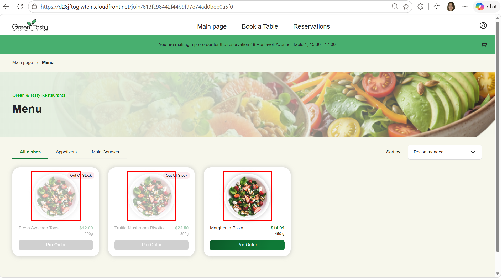
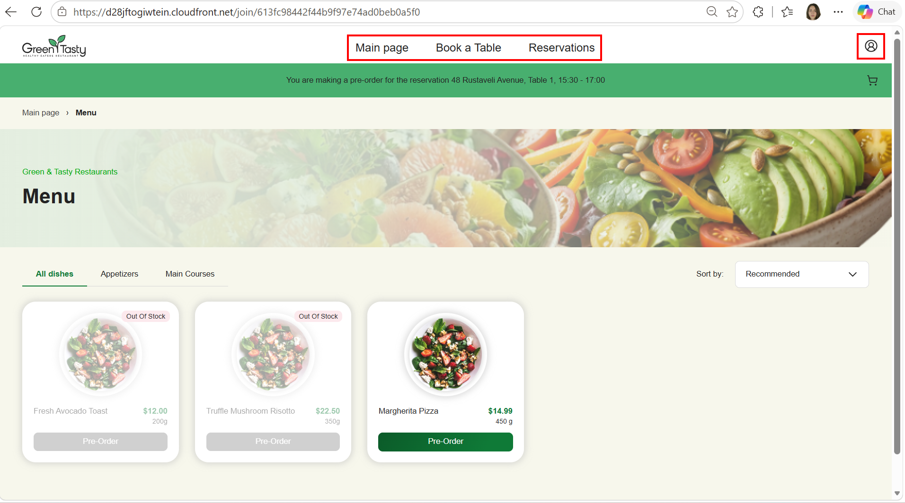
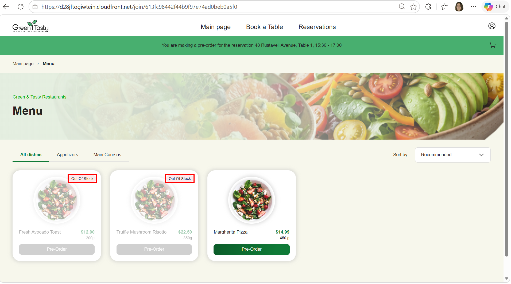
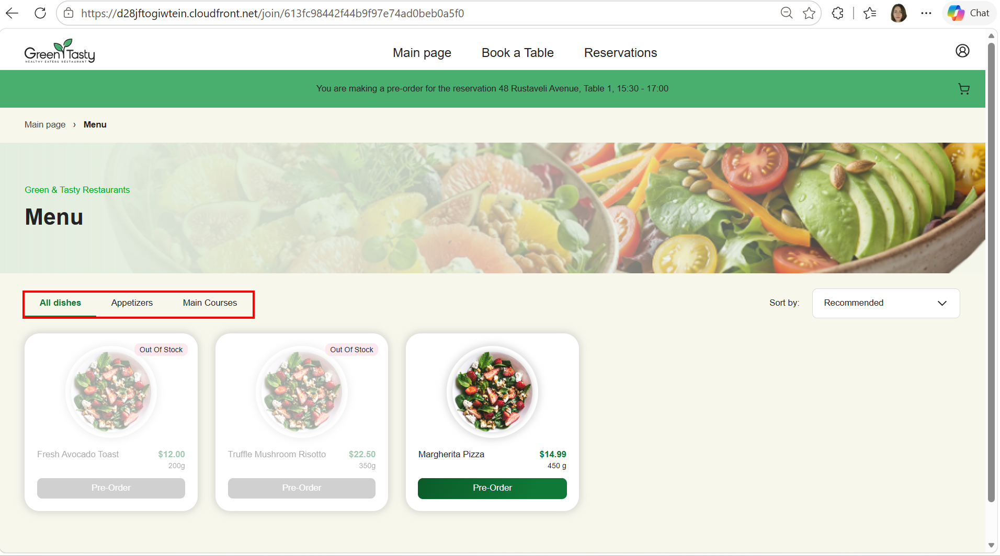
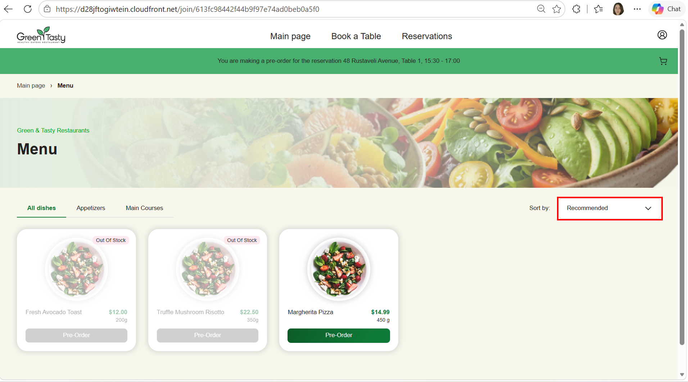
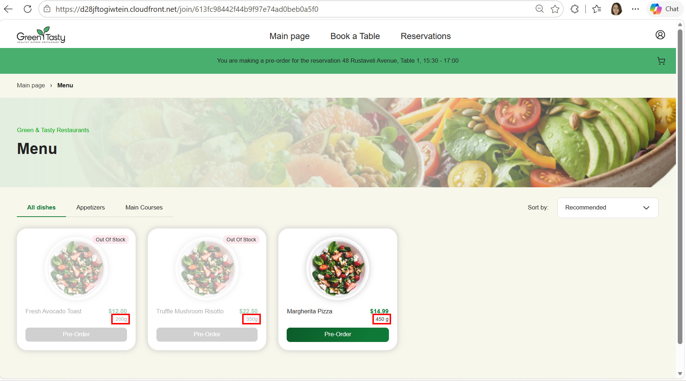

# Defect Reports — US11 Guest Viewing Reservation Menu

Format follows the course template (ID, Summary, Pre-conditions, Steps, Actual result, Expected result, Attachments). Severity and Priority are added to help triage.

**Environment (all reports):** `https://d28jftogiwtein.cloudfront.net`, Menu page opened from the invite link `/join/<token>`, desktop browser, ~1900 px wide.

**Common pre-conditions:**
- The Owner has generated and shared a valid invite link.
- Reservation status is "Reserved" (48 Rustaveli Avenue, Table 1, 15:30 - 17:00).

**Common first steps:**
1. Guest is redirected by the invite link.
2. Guest enters a name in the "You're invited" pop-up and clicks [Browse menu].

---

### ID: 1
**Summary:** All dishes on the Menu page show the same image ("Fresh Strawberry Mint Salad")

| | |
|---|---|
| **Severity / Priority** | Major / High |
| **Pre-conditions** | Common pre-conditions. The location has dishes "Fresh Avocado Toast", "Truffle Mushroom Risotto", "Margherita Pizza". |
| **Steps** | 1. Guest is redirected by the invite link. 2. Guest enters a name and clicks [Browse menu]. 3. Look at the images on the dish cards in the "All dishes" tab. |
| **Actual result** | "Fresh Avocado Toast", "Truffle Mushroom Risotto" and "Margherita Pizza" all show the same salad photo (strawberries and greens). |
| **Expected result** | Each card shows the image of its own dish (US11 AC2: "Each menu item must clearly display ... image"; Figma: every card has its own dish photo). |
| **Attachments** |  |

### ID: 2
**Summary:** Guest sees the customer header (Main page, Book a Table, Reservations, profile) instead of the Guest variant header

| | |
|---|---|
| **Severity / Priority** | Major / Medium |
| **Pre-conditions** | Common pre-conditions. The Guest isn't signed in. |
| **Steps** | 1. Guest is redirected by the invite link. 2. Guest enters a name and clicks [Browse menu]. 3. Look at the page header. |
| **Actual result** | The header shows the navigation links "Main page", "Book a Table", "Reservations" and the profile icon. |
| **Expected result** | The Guest variant header is shown: the logo and the cart icon only (Figma note "Change: Guest variant Header"). |
| **Attachments** |  |

### ID: 3
**Summary:** Reservation banner doesn't show the reservation date

| | |
|---|---|
| **Severity / Priority** | Major / Medium |
| **Pre-conditions** | Common pre-conditions. |
| **Steps** | 1. Guest is redirected by the invite link. 2. Guest enters a name and clicks [Browse menu]. 3. Look at the text in the green banner under the header. |
| **Actual result** | "You are making a pre-order for the reservation 48 Rustaveli Avenue, Table 1, 15:30 - 17:00": there's no date, so the Guest can't tell which day the pre-order is for. |
| **Expected result** | The banner includes the date: "You are making a pre-order for the reservation 48 Rustaveli Avenue, Table 1, &lt;Mon DD, YYYY&gt;, 15:30 - 17:00" (Figma: "...Table 1, Oct 17, 2026, 12:00 - 13:30"). |
| **Attachments** |  |

### ID: 4
**Summary:** Unavailable dish badge says "Out Of Stock" instead of "Sold Out"

| | |
|---|---|
| **Severity / Priority** | Minor / Low |
| **Pre-conditions** | Common pre-conditions. "Fresh Avocado Toast" and "Truffle Mushroom Risotto" are marked "On Stop". |
| **Steps** | 1. Guest is redirected by the invite link. 2. Guest enters a name and clicks [Browse menu]. 3. Look at the badge in the top-right corner of the "Fresh Avocado Toast" card. |
| **Actual result** | The badge text is "Out Of Stock". |
| **Expected result** | The badge text is "Sold Out" (Figma). Note: the User Story calls this state "On Stop", so the label should be agreed with the BA and designer (see analysis E1). |
| **Attachments** |  |

### ID: 5
**Summary:** Category tabs don't match the design: "Desserts" is missing and an extra "All dishes" tab is selected by default

| | |
|---|---|
| **Severity / Priority** | Major / Medium |
| **Pre-conditions** | Common pre-conditions. |
| **Steps** | 1. Guest is redirected by the invite link. 2. Guest enters a name and clicks [Browse menu]. 3. Look at the category tabs above the dish list. |
| **Actual result** | Tabs are "All dishes", "Appetizers", "Main Courses". "All dishes" is selected. There's no "Desserts" tab. |
| **Expected result** | Tabs are "Appetizers", "Main Courses", "Desserts", and "Appetizers" is selected by default (Figma; US11 AC1 lists Appetizers, Main Course, Desserts as categories). |
| **Attachments** |  |

### ID: 6
**Summary:** "Sort by" default option is "Recommended" instead of "Popular First"

| | |
|---|---|
| **Severity / Priority** | Minor / Low |
| **Pre-conditions** | Common pre-conditions. |
| **Steps** | 1. Guest is redirected by the invite link. 2. Guest enters a name and clicks [Browse menu]. 3. Look at the value of the "Sort by" dropdown. |
| **Actual result** | "Sort by" shows "Recommended". |
| **Expected result** | "Sort by" shows "Popular First" by default. The options are Popular First, Newest First, Price: Low to High, Price: High to Low (Figma, "New Filter component"). |
| **Attachments** |  |

### ID: 7
**Summary:** Dish weight format is inconsistent: "200g" / "350g" vs "450 g"

| | |
|---|---|
| **Severity / Priority** | Trivial / Low |
| **Pre-conditions** | Common pre-conditions. |
| **Steps** | 1. Guest is redirected by the invite link. 2. Guest enters a name and clicks [Browse menu]. 3. Compare the weight under the price on each dish card. |
| **Actual result** | "Fresh Avocado Toast": "200g", "Truffle Mushroom Risotto": "350g" (no space); "Margherita Pizza": "450 g" (with space). |
| **Expected result** | The weight has the same format on every card, with a space before the unit: "200 g", "350 g", "450 g" (Figma: "430 g"). |
| **Attachments** |  |
