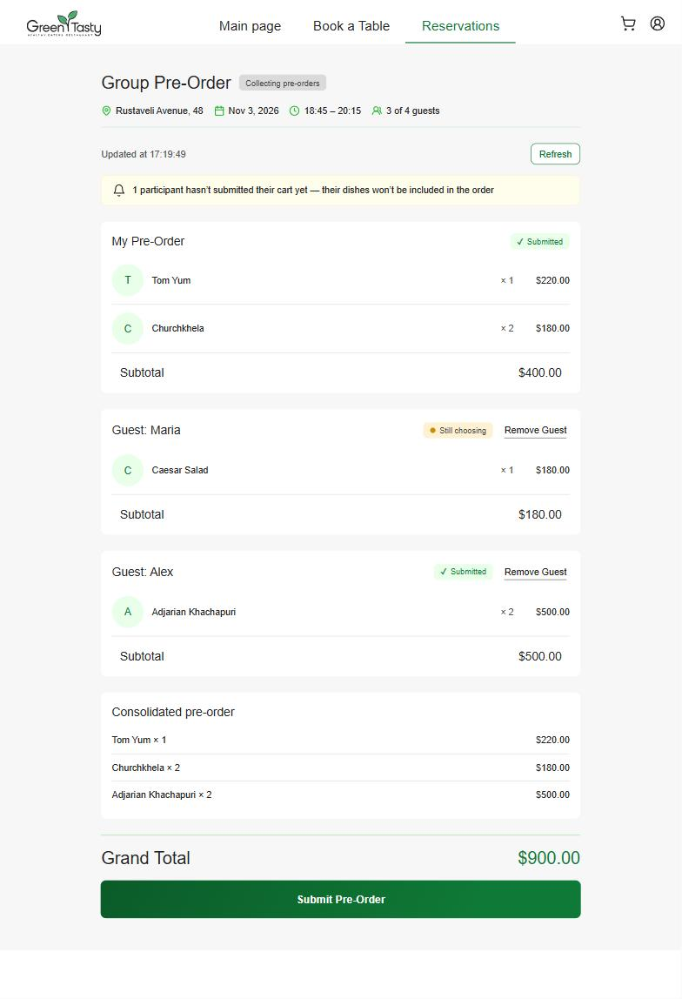
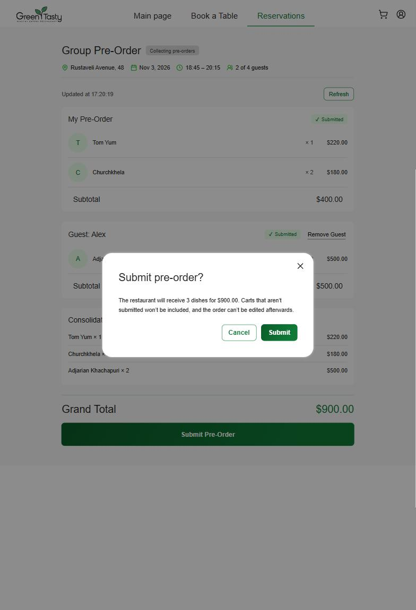
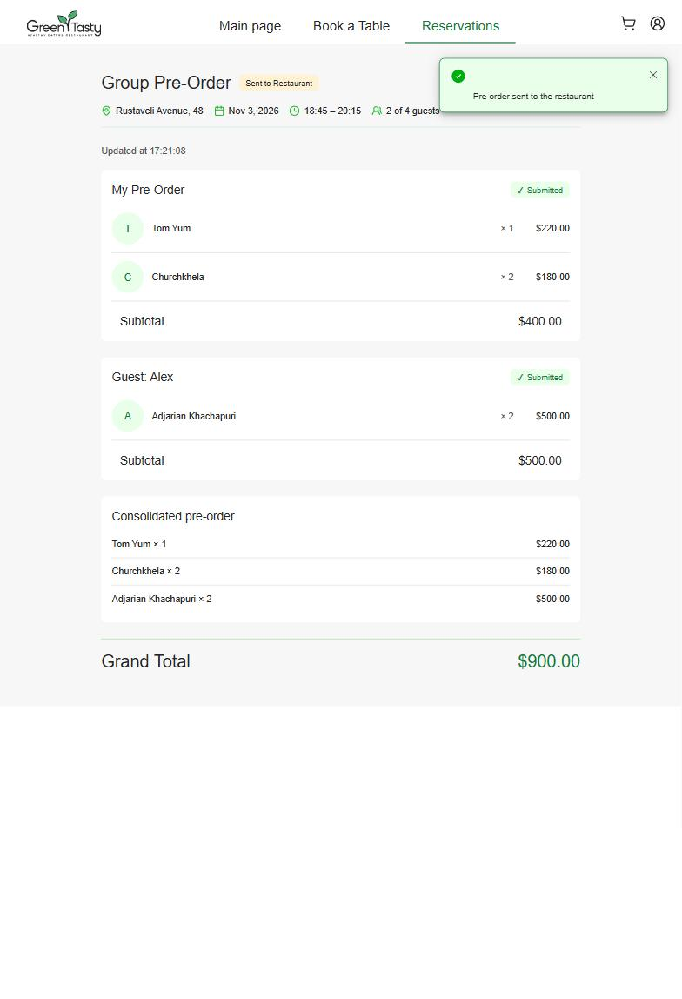
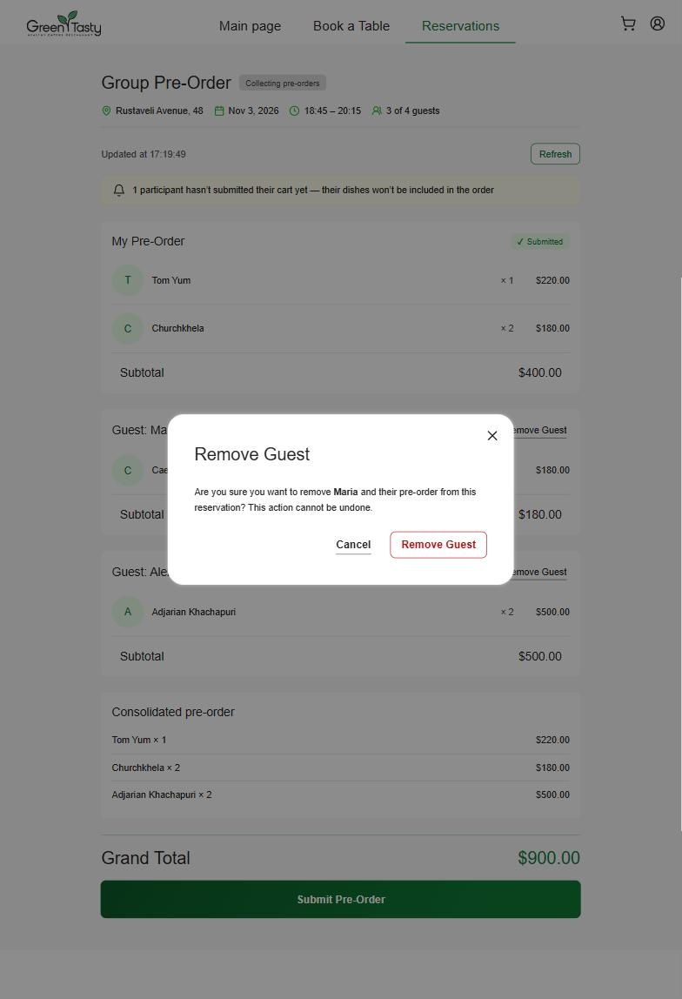
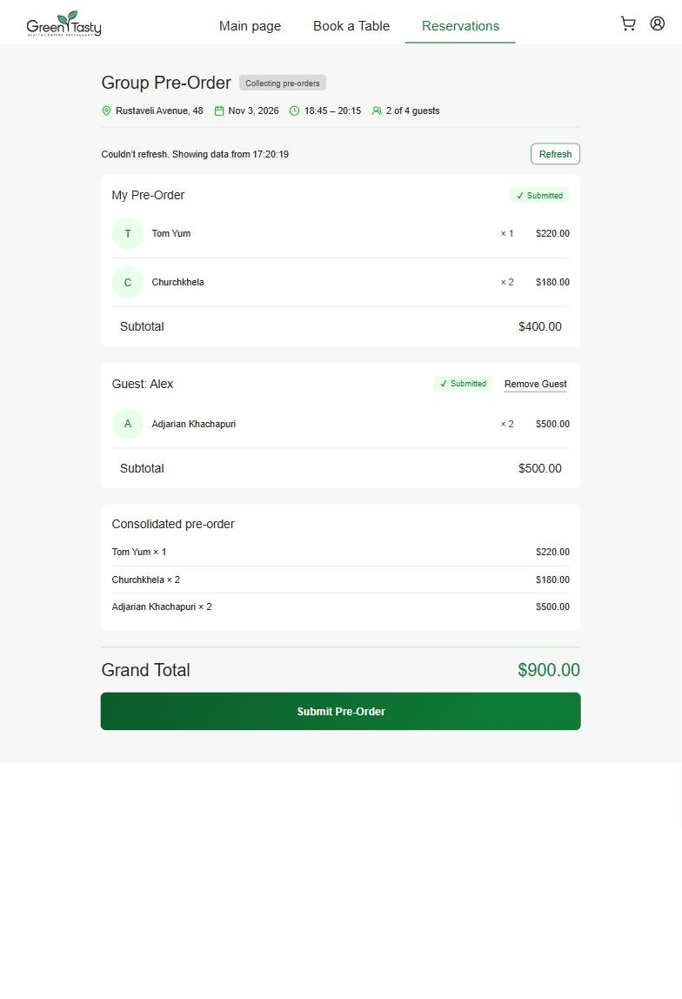
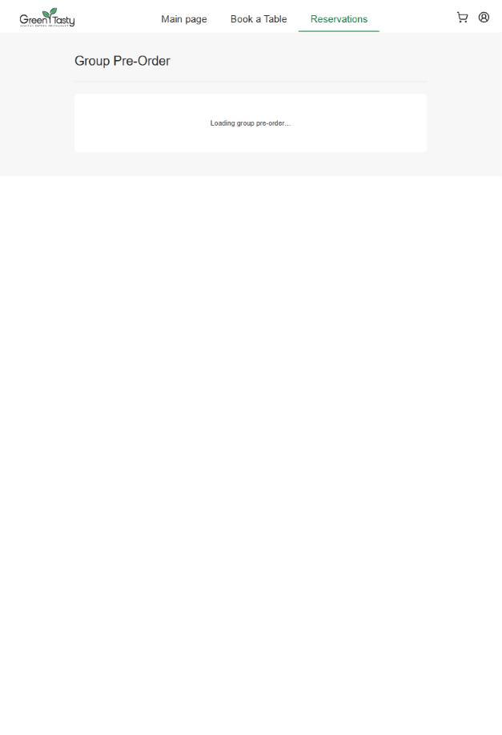
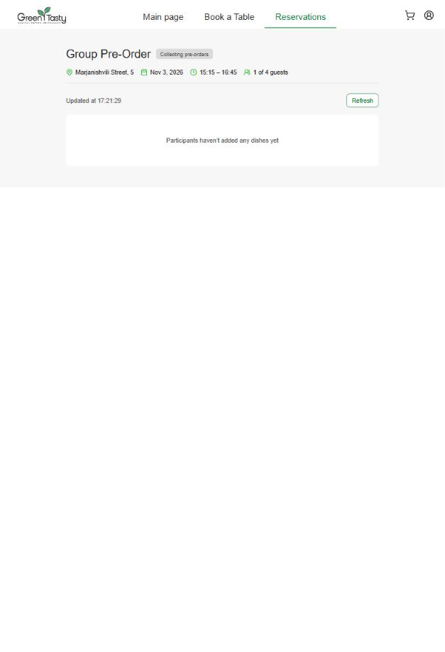
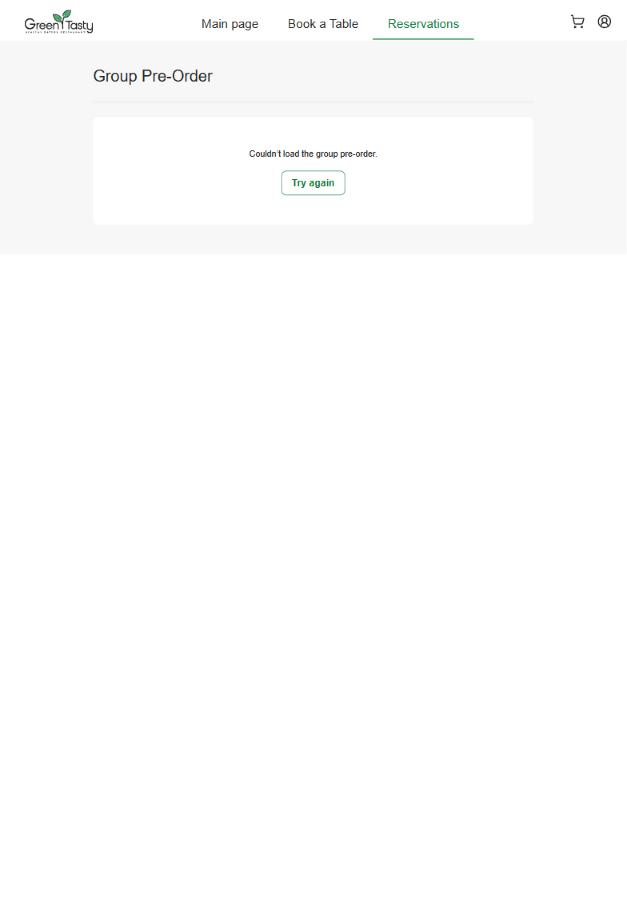
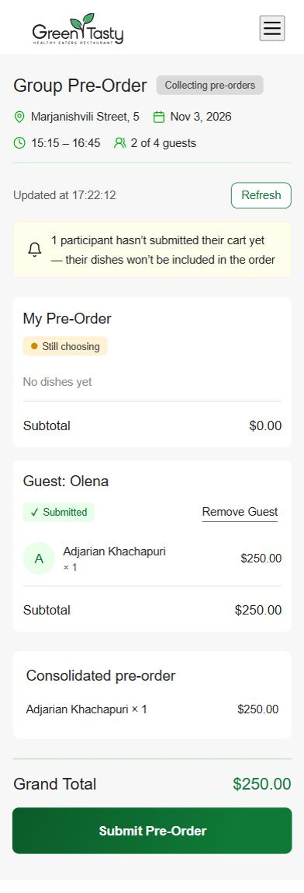

# Frontend Homework Report — Group Pre-Order (Owner Flow)

**Feature:** the owner of a group reservation sees what every guest picked and confirms one consolidated pre-order for the restaurant.

- Live site: https://d11rv63sjw7xpo.cloudfront.net/ (screen: `/reservations/<reservationId>/group-order`)
- Code: `frontend/restaurant-frontend-app` — page `pages/group-order-page`, card `components/group-orders/participant-card`, service `services/group-orders`
- Merged pull requests: [sadturn/maraphon-2026#1](https://github.com/sadturn/maraphon-2026/pull/1) (level 3, bonus, backend fixes), [sadturn/maraphon-2026#2](https://github.com/sadturn/maraphon-2026/pull/2) (owner card on first load)

## Scope

| Part | Status | Homework tests |
|---|---|---|
| Practice — participant card and participants page | ✅ Done | 8 / 8 |
| Level 1 — Owner Review screen layout on static data | ✅ Done | 5 / 5 (replaced by level 2, as the task says) |
| Level 2 — group pre-order on the mock backend | ✅ Done | 5 + 13 |
| Level 3 — real API integration and background sync | ✅ Done | 3 + 6 |
| Bonus — Remove Guest | ✅ Done | 1 + 5 |

`npm run test:hw` — **69 / 69 passing** (homework suites above plus the `consolidatePreOrder` helper tests and 2 extra tests for the load order).

## What was done

### Practice
- Route `reservations/:reservationId/group-order` and the `GroupOrderPageComponent` page with the list of participants.
- `ParticipantCardComponent` (standalone, `input()` signals): title "My Pre-Order" / "Guest: Alex", dishes with quantity and price, subtotal.

### Level 1 — layout
- Header "Group Pre-Order": address, date, time and "N of M guests" with icons (`date` pipe), Grand Total with the `currency` pipe.
- Page and card styles from the Figma design; colours from `app/shared/styles/abstracts/colors` via `@use … as color`.
- Semantics: `<main>`, one `<h1>`, participants in `<ul>`/`<li>`, card is an `<article>`.
- Cart status is shown with text and an icon ("✓ Submitted" / "Still choosing"), not only with colour.
- No horizontal scroll at 375 px (see the mobile screenshot).

### Level 2 — mock backend
- `GroupOrdersService` with a method per endpoint: invite (`invite-token` → `guest/invites/{token}`), sessions, owner session id, status, submit.
- Page state in `signal()`, derived values in `computed()`; the owner's card is labelled **My Pre-Order** (`participant.id === guestSessionId`).
- "Consolidated pre-order" block: `computed(() => consolidatePreOrder(participants()))`. **Grand Total is the sum of the consolidated order**, so only submitted carts count.
- Yellow notice when someone hasn't submitted: "N participants haven't submitted their cart yet — their dishes won't be included in the order".
- Status badge: Open → "Collecting pre-orders", Submitted → "Sent to Restaurant".
- **Submit Pre-Order** → confirmation in the shared `<app-modal>` → submit → toast "Pre-order sent to the restaurant", read-only screen.
- States: loading, error with "Try again", empty ("Participants haven't added any dishes yet"), "Group reservation not found".
- Submit is disabled when submitted carts have no dishes and while the request is running, so a double click can't send twice; a failed submit keeps the screen usable (the error toast comes from `tokenInterceptor`).

### Level 3 — real API
- `backendUrl` in `environment.development.ts` points to the deployed API Gateway stage.
- **Background sync:** while the group is `Open`, sessions and status refresh every 15 s (`interval` + `exhaustMap`, so a new request never starts while the previous one is pending). One timer only: "Try again" stops the old one, the timer stops after Submit, when the server reports a non-open status, and on leaving the page (`takeUntilDestroyed`).
- No full-screen loader during background refresh — the data just changes.
- "Updated at HH:mm:ss" line and a **Refresh** button for an immediate sync.
- A failed background refresh keeps the last data and shows "Couldn't refresh. Showing data from …" without a toast: `getSessions$(id, { silent: true })` and `getStatus$(id, { silent: true })` send `HttpContext` with `SKIP_ERROR_TOAST`.
- Real backend errors on Submit (no submitted carts, no order) are shown as a toast with the API message; the screen keeps working.

### Bonus — Remove Guest
- "Remove Guest" on every guest's card (not on the owner's, not after submit), `aria-label="Remove Alex"`.
- Card API: `canRemove = input(false)` and `removeClick = output<Participant>()`; the page owns the logic.
- Confirmation in `<app-modal>` as in the design: "Are you sure you want to remove **Alex** and their pre-order from this reservation? This action cannot be undone."
- `removeSession$(groupId, guestSessionId)` → `DELETE /guest/groups/{groupReservationId}/sessions/{guestSessionId}`; the list and totals update from the server response through the same `computed()` values.

### Extra fixes found while testing against the real API
- **Frontend, `tokenInterceptor`:** `GET/DELETE /guest/groups/{id}/sessions` is behind the Cognito authorizer, but guest URLs were sent without a token (the browser saw it as a CORS error). The signed-in user's token is now added to this endpoint only; the guest branch now also respects `SKIP_ERROR_TOAST`.
- **Frontend, first load:** the owner's card appeared only after the first sync on a new reservation, because the owner session is created by `guest-session-id`, which ran in parallel with the first `/sessions` call. The page now loads the owner session id first.
- **Backend:** the owner's own session was counted as a joined guest (a 2-guest reservation was "full" right after the owner opened the screen); a full group made `GET /guest/invites/{token}` fail, which broke the owner screen; the owner's own order was not shown in "My Pre-Order". All three are fixed with unit tests (backend: 163 / 163).
- **Deployment:** redeployed the API Gateway routes and the `api-handler` lambda (the stage was missing the new endpoints), added an idempotent seed script for demo data (`backend/restaurant-backend-app/seed/`), deployed the frontend to S3 + CloudFront.

## Screenshots

All screenshots are from the deployed site (CloudFront) working against the real API.

| | |
|---|---|
| **Owner review** — header, badge, "Updated at" + Refresh, yellow notice, My Pre-Order, guests with status and Remove Guest, consolidated order, Grand Total |  |
| **Submit confirmation** |  |
| **Sent to Restaurant** — badge, toast, read-only screen |  |
| **Remove Guest confirmation** (bonus) |  |
| **Background refresh failed** — last data kept, no toast. The network failure was simulated in the browser to capture this state. |  |
| **Loading** |  |
| **Empty** |  |
| **Error with Try again** (reservation of another user, API returns 403) |  |
| **Mobile, 375 px** |  |

## How it was verified

**Automated**
- `npm run test:hw` — 69 / 69.
- `npx tsc -p tsconfig.app.json --noEmit` and `npx tsc -p tsconfig.spec.json --noEmit` — no errors.
- `BACKEND_URL=https://example.com npm run build` — "Bundle check passed", initial bundle 643 kB.
- `token.interceptor.spec.ts` — 6 / 6; backend `dotnet test` — 163 / 163.

**Manual, against the deployed API** (local dev server first, then the CloudFront site)
1. Signed in as a customer and booked a table for 2+ guests.
2. A guest joined the group (through the guest API with the invite's group id, as the guest page does) and added dishes; the owner's screen showed the new cart within 15 s without a page reload, then "Submitted" after the guest confirmed.
3. Refresh updated the "Updated at" time immediately; no full-screen loader during background refresh.
4. Owner's own pre-order appeared in "My Pre-Order" and in the consolidated order.
5. Remove Guest: `DELETE` returned 200, the guest disappeared and the totals were recalculated.
6. Submit: the badge changed to "Sent to Restaurant", the toast appeared, the screen became read-only, background requests stopped (none in the following 20 s), and the API reported the group as `Submitted`.
7. Checked the screen at 375 px width — no horizontal scroll.

## AI usage

- Level 3, the bonus, the frontend and backend fixes, the deployment and this report were done with **Claude Code** (model Claude Opus 5.5) as a pair programmer. I approved every commit message before it was committed, and I opened, reviewed and merged the pull requests myself. Results were checked with the automated gates and manually against the real API as described above.
- The practice and levels 1–2 were done without AI.

## Known limitations

- After Submit, reopening the owner screen fails: `GET /guest/invites/{token}` returns `GroupReservationExpired` for groups that are no longer open (backend behaviour, out of scope for this homework).
- In pre-order mode the menu lists dishes from all locations, so an owner can add a dish from another location to their order.
